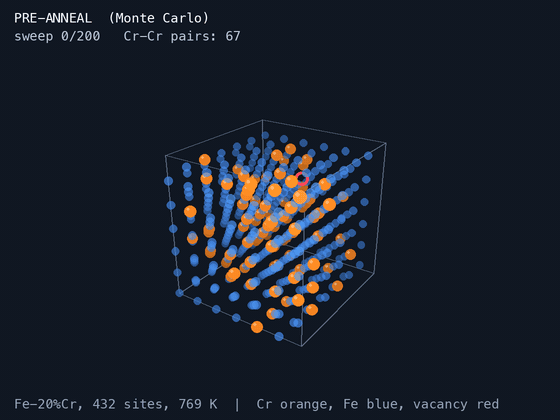
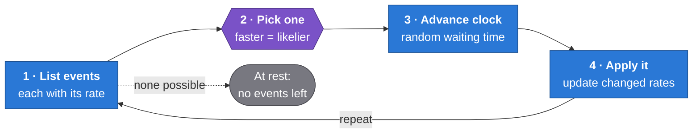
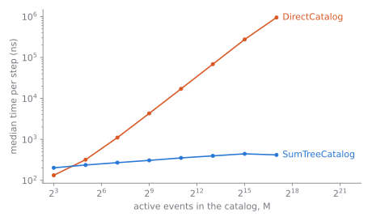

# okrates — Kinetic Monte Carlo Simulation in Rust and Python

[](https://github.com/vzordillo/okrates)
[](https://github.com/vzordillo/okrates/actions/workflows/rust.yml)
[](https://github.com/vzordillo/okrates/actions/workflows/python.yml)
[](LICENSE)

## About this repository

`okrates` is a residence-time (rejection-free) kinetic Monte Carlo (kMC) framework written in Rust, with typed Python bindings.

`okrates` is an experiment in fully agentic scientific software development. The code, tests and reviews are produced by AI coding agents working under the maintainer's direction:
- [Google Antigravity](https://antigravity.google/use-cases/science/) with Google's frontier Gemini models, through Google's free access offer for scientists;
- Anthropic Claude models through [Claude Code](https://claude.com/claude-code).

<table>
  <tr>
    <td width="50%"></td>
    <td width="50%"></td>
  </tr>
  <tr>
    <td>Thermal ageing of Fe–20 % Cr (Martínez 2012 energetics, 432 BCC sites, 769 K): Cr atoms cluster during 400 Kawasaki Monte Carlo sweeps, then a single vacancy makes 4,000 kinetic Monte Carlo jumps through the alloy.</td>
    <td>Irradiation of Fe–10 % Cr (432 BCC sites, 573 K, accelerated damage rate of 3×10⁴ dpa/s): Frenkel pairs of vacancies and self-interstitial dumbbells are created, the dumbbells migrate quickly, and the defects recombine or are absorbed at the sink plane (pink). Over 6,000 events (1.5 dpa), 560 of 588 pairs recombine and the rest reach the sink.</td>
  </tr>
</table>

## What it does

okrates simulates continuous-time Markov chains in the residence-time form of Bortz, Kalos and Lebowitz. You describe a system by its states, the transitions that can leave each state, and their rates. The engine draws each event with probability proportional to its rate, advances a continuous clock by an exponentially distributed waiting time, and applies the event. Nothing in the engine assumes a lattice, a material or a particular kind of event.

Two event catalogs give identical statistics at different cost. The direct catalog recomputes every rate each step. The sum-tree catalog updates only the rates an event actually changes, which keeps a step cheap even with hundreds of thousands of possible events.

Runs are reproducible in a strict sense. Every replica and every purpose (dynamics, initial state, defect creation) draws from its own seeded random stream, so an ensemble gives the same numbers on any number of threads. A checkpoint stores the full generator and clock state, and a resumed run continues bit for bit. Run manifests record hashes of the parameters, barrier tables and checkpoints behind each result.

## Design

A kinetic Monte Carlo code has two parts that change for different reasons. The physics, meaning which states exist, which transitions are possible and how fast they happen, changes with every material and mechanism. The algorithm, meaning how an event is chosen, how time advances and how the event list stays current, is the same for all of them. okrates keeps the two apart: a model describes physics only, and the engine owns selection, time, randomness and checkpoints. A new mechanism means writing a new model, and the engine's guarantees come with it.

```mermaid
%%{init: {"themeVariables": {"fontSize": "18px"}, "flowchart": {"nodeSpacing": 24, "rankSpacing": 50, "padding": 10}}}%%
flowchart LR
    lang(["🐍 Python<br>🦀 Rust"])
    subgraph model["🧪 Your model"]
        direction TB
        states["States<br><i>atoms, defects, species</i>"]
        moves["Transitions<br><i>what can happen next</i>"]
        rates["Rates<br><i>how fast, e.g. from DFT</i>"]
    end
    subgraph engine["⚙️ okrates engine"]
        direction TB
        pick{{"Event selection<br><i>direct or sum tree</i>"}}
        clock{{"Continuous-time clock"}}
        rng{{"Seeded random streams"}}
        ckpt{{"Exact checkpoints"}}
    end
    subgraph out["📈 Results"]
        direction TB
        traj[/"Trajectories"/]
        transport[/"Diffusivities, correlation<br>factors, defect counts"/]
        prov[/"Provenance records"/]
    end
    lang -.-> model ==> engine ==> out
    classDef lang fill:#d95926,stroke:#8f3a18,color:#ffffff
    classDef model fill:#2a78d6,stroke:#1b4f8f,color:#ffffff
    classDef engine fill:#7a52c7,stroke:#4d3285,color:#ffffff
    classDef result fill:#1f9e78,stroke:#13664d,color:#ffffff
    class lang lang
    class states,moves,rates model
    class pick,clock,rng,ckpt engine
    class traj,transport,prov result
```



## How a step works

With rates r₁ … r_M of the possible events and total rate R = Σ rᵢ, one step draws two uniform random numbers u₁ and u₂ in (0, 1). The first selects event i as the smallest index with u₁·R < r₁ + … + rᵢ. The second gives the waiting time Δt = −ln(u₂)/R. The event is applied and only the rates it changed are updated. If R = 0, nothing can happen and the run stops without drawing. A step either completes fully or leaves the simulation exactly as it was.



## Getting started

Rust 1.100.0 is pinned in `rust-toolchain.toml` (minimum supported 1.88).

```console
cargo test
cargo run --example random_walk -- 42 5
```

Python ≥ 3.10, in any virtualenv or conda environment (`numpy>=2.2` is installed as a dependency):

```console
pip install maturin==1.16.0
maturin develop
python examples/python/vacancy_diffusivity.py
```

The test cases below use release builds (`cargo run --release`, `maturin develop --release`) because the runs are longer. The outputs shown were produced on a Linux x86_64 workstation. Random numbers are reproducible, but timings and the last digits of some floating-point results can differ on other platforms.

## Test cases

Each case starts from a published or exact reference, rebuilds it in okrates, and compares. The steps say what we implemented, which parameters came from the source, and which choices we had to make where the source is silent.

### 1. Random walk of a single vacancy in BCC

**Reference.** A vacancy on a BCC lattice that jumps to each of its eight nearest neighbours with the same rate r performs an uncorrelated random walk. Each jump has length √3·a/2, so the exact diffusivity is D = ⟨R²⟩/6t = r·a².

**How we built it.**

1. A BCC lattice with periodic boundaries, and one vacancy that can jump to its eight neighbours (`crates/okrates-models/src/vacancy.rs`).
2. An Arrhenius rate r = ν exp(−E_m/k_BT) with illustrative values ν = 10¹³ s⁻¹, E_m = 0.65 eV, T = 800 K and a = 2.8665 Å. These are not a fitted Fe parameter set; the test only needs a known r.
3. 2,000 independent runs of 1,000 expected jumps each, with D estimated from the mean squared displacement against time.

**How to run it.**

```text
cargo run --release -p okrates-models --example vacancy_msd
```

```text
D_theory = 6.605171778304e-11 m^2/s
d_hat = 6.683048898106e-11 m^2/s
se = 1.067433630227e-12 m^2/s
z_score_vs_theory = 0.729573414189
runs = 2000
```

**Result.** The estimate lies 0.73 standard errors from r·a². The figure shows the mean squared displacement of 200 runs on a common time grid against the exact line 6·r·a²·t.

<p align="center"></p>

### 2. Vacancy diffusion in Fe–Cr alloys

**Reference.** E. Martínez, O. Senninger, C.-C. Fu and F. Soisson, "Decomposition kinetics of Fe–Cr solid solutions during thermal aging", Phys. Rev. B 86, 224109 (2012), [doi:10.1103/PhysRevB.86.224109](https://doi.org/10.1103/PhysRevB.86.224109). The paper builds an atomistic kMC model of vacancy diffusion in Fe–Cr from DFT: pair interactions that depend on the local composition (their Table I), saddle-point interactions, and migration barriers for vacancy–solute configurations (their Table II).

**What the source reports.** Twenty migration barriers in Table II, given to 0.01 eV, and in Fig. 4 the model tracer diffusivities of Fe and Cr in dilute alloys against 1000/T. Read from the figure, the ratio D*_Cr/D*_Fe is 2.03, 2.12, 2.21 and 2.31 at 1000/T = 1.0, 1.1, 1.2 and 1.3.

**How we built it.**

1. We transcribed Tables I and II and wrote the energy model (`crates/okrates-models/src/fecr_martinez.rs`): composition-dependent first- and second-neighbour pair energies, local composition measured around each bond, and saddle-point energies refitted at the run temperature.
2. Where the paper is ambiguous we chose the reading that reproduces Table II. Table I prints the sign of one pair term in a way that contradicts the paper's own equation; with the equation's sign, Table II is reproduced to 0.005 eV, and with the printed sign it is off by about 0.06 eV.
3. We added one rule the paper does not state. In annealed alloys at high Cr content a few configurations give a slightly negative barrier. We floor the saddle energy at the higher of the initial and final energies, which keeps detailed balance exact, and we count every activation. It never triggers in the dilute runs below.
4. The diffusion runs use a box of 432 sites with one vacancy, a Kawasaki (Fe↔Cr swap) anneal of the Cr arrangement before the dynamics, 64 replicas of about 10⁶ jumps each, and tracer diffusivities from the slope of the mean squared displacement.

**How to run it.** The barrier comparison is a test, and the diffusion calculations run from Python after `maturin develop --release`:

```text
cargo test --locked -p okrates-models --test fecr_martinez
```

The comparison with the paper's Fig. 4 is a script. It takes about 6 minutes for the four dilute points on our 18-core Linux x86_64 workstation (measured), and it prints one row per point with the diffusivities, their ratio, the correlation factor and their standard errors. These rows are the numbers in the result below:

```text
python examples/python/fecr_martinez_comparison.py 1e6 64 4
```

The short example below is a quick, smaller calculation. It illustrates the interface and is not the run behind those numbers:

```python
import okrates

result = okrates.run_fecr_diffusion(
    lattice=okrates.LatticeConfig(cells=(4, 4, 4), lattice_parameter_m=2.8665e-10),
    energetics=okrates.Martinez2012Config(barrier_policy="symmetric_floor"),
    cr_count=25,
    temperature_k=800.0,
    sampling=okrates.SamplingConfig(t_end=5e-8, sample_count=20, fit_method="windowed_ols"),
    anneal=okrates.AnnealConfig(sweeps=50),
    runs=16,
    seed=2026,
)
print(f"D*_Cr = {result.D_Cr:.3e} +/- {result.D_Cr_se:.1e} m^2/s")
print(f"D*_Fe = {result.D_Fe:.3e} +/- {result.D_Fe_se:.1e} m^2/s")
```

```text
D*_Cr = 1.118e-11 +/- 6.0e-13 m^2/s
D*_Fe = 2.364e-12 +/- 7.6e-14 m^2/s
```

**Result.** Nineteen of the twenty Table II barriers agree within half the last printed digit (0.005 eV); the twentieth, H5 in Cr, is off by 0.0052 eV. In dilute alloys (2 Cr in 431 atoms, 769–1000 K) the ratio D*_Cr/D*_Fe is 1.86–2.39, against 2.03–2.31 from the paper's figure, with every point within 2.1 standard errors. The self-diffusion correlation factor in Fe comes out at 0.729–0.738, consistent with the value 0.7314 ± 0.0025 that okrates gives for the same 432-site box. The figure repeats the calculation in a smaller dilute run (4 Cr in 432 sites, 128 runs) from 700 to 1100 K and shows Cr diffusing about twice as fast as Fe throughout.

<p align="center"></p>

### 3. Self-interstitials and radiation damage in Fe–Cr

**Reference.** O. Senninger et al., "Modeling radiation induced segregation in iron–chromium alloys", Acta Mater. 103, 1–11 (2016), [doi:10.1016/j.actamat.2015.09.058](https://doi.org/10.1016/j.actamat.2015.09.058). The paper adds ⟨110⟩ self-interstitial dumbbells to the Martínez vacancy model, creates Frenkel pairs at a damage rate, and studies Cr segregation at a grain boundary treated as a perfect sink.

**What the source reports.** Binding energies of dumbbell–solute configurations from their own kMC model (their Table 2, 14 configurations), dumbbell migration barriers of 0.34 eV (Fe–Fe), 0.23 eV (mixed Fe–Cr) and about 0.05 eV (Cr–Cr), a distribution of barriers near one Cr atom (their Fig. 2), and the RIS results of their Sec. 4.

**How we built it.**

1. The fitted dumbbell interaction values are not published, so we reconstructed them. We fitted the model of their Eq. 3 to Table 2 and to the three barriers, minimising the largest residual. Twelve of the fourteen configurations are dumbbells in an Fe matrix, and these are reproduced within 0.0086 eV. That is the best any fit of this model can do, because the published values themselves violate one of the model's linear relations by 0.069 eV. The two configurations in a Cr matrix are not reproduced.
2. The 0.34 and 0.23 eV barriers are reproduced exactly. The saddle term for an Fe atom jumping next to Cr was fitted to the largest single-Cr barrier in Fig. 2 (0.440 eV); the median of our 22 single-Cr barriers is then 0.336 eV, against 0.337–0.340 eV read from the figure.
3. The lattice energies depend on temperature as in Martínez et al., so the dumbbell saddle terms are refitted at the run temperature. This keeps the pure-Fe barriers at their fitted values at every temperature.
4. The model (`crates/okrates-models/src/fecr_ris.rs`) creates a Frenkel pair at a random site with the interstitial placed at the end of a straight 10-step ⟨111⟩ replacement chain, recombines a vacancy and an interstitial within the fourth neighbour shell, and absorbs defects that reach a sink plane. The pool of defect records has a fixed size, so the fast sum-tree catalog applies.

**How to run it.**

```text
cargo run --release -p okrates-models --example fecr_ris_pilot -- --temperature 600 --k0 1e-3 --dpa-end 1e-2 --capacity 4096 --seed 1 --cells 32 8 8
```

```text
box=[32, 8, 8] sites=4096 cr=410 T=600 K0=1e-3 dpa_end=1e-2 P=4096 seed=1
final steps=122893 t=1.020147e1 dose=1.020147e-2 V=1 I=1 V_peak=1 I_peak=1 V_mean=0.0000 I_mean=0.0000 created=38 recombined=21 absorbed_V=16 absorbed_I=16 borrowed_fe=0 creation_attempts=43 floored_dumbbell=6631 floored_vacancy=0 us_per_step=66.51
```

**Result so far.** The parameters reproduce the paper's tables as described above, and the model passes its consistency tests: detailed balance for every jump, exact defect bookkeeping (38 pairs created, 21 recombined, 16 vacancies and 16 interstitials absorbed, one of each left), and bit-for-bit restarts. The comparison with the paper's interstitial diffusivities and segregation profiles is in progress.

## Performance

The two catalogs produce the same statistics; they differ in cost. The `catalog_scaling` example runs a synthetic model in which every event changes eight rates, with up to 131,072 possible events:

```text
cargo run --release -p okrates-core --example catalog_scaling
```

The direct catalog's cost grows in proportion to the number of events, while the sum tree stays between about 200 and 450 ns per step. At 32,768 events the sum tree is about 620 times faster on our Linux x86_64 workstation.

<p align="center"></p>

## Testing

The fast tier runs in a few seconds; the full tier adds statistical, equivalence and end-to-end tests:

```text
cargo test --locked                          # fast tier
cargo test --locked -- --include-ignored     # full tier
pip install pytest==9.2.0
pytest -q python/tests                       # Python, after maturin develop
```

Regression tests pin results bit for bit. Where platform maths libraries differ in the last bit, we pin values per target (architecture and operating system).

## License

[MIT](LICENSE)
