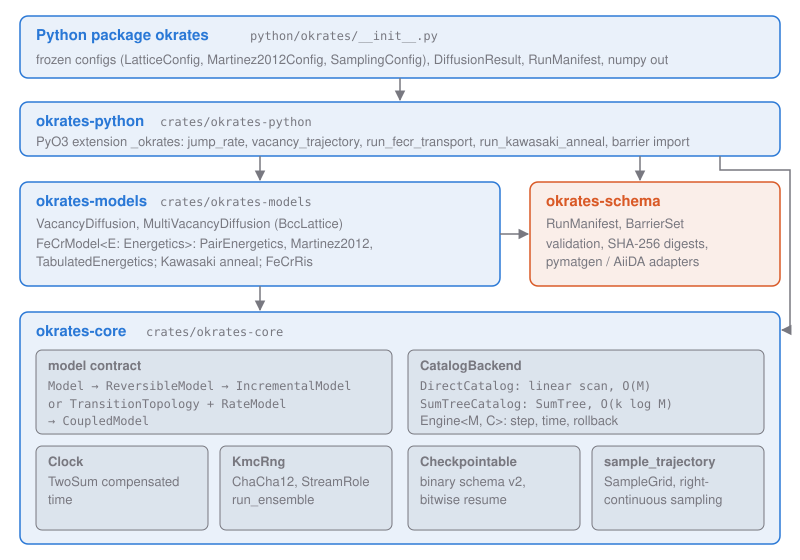
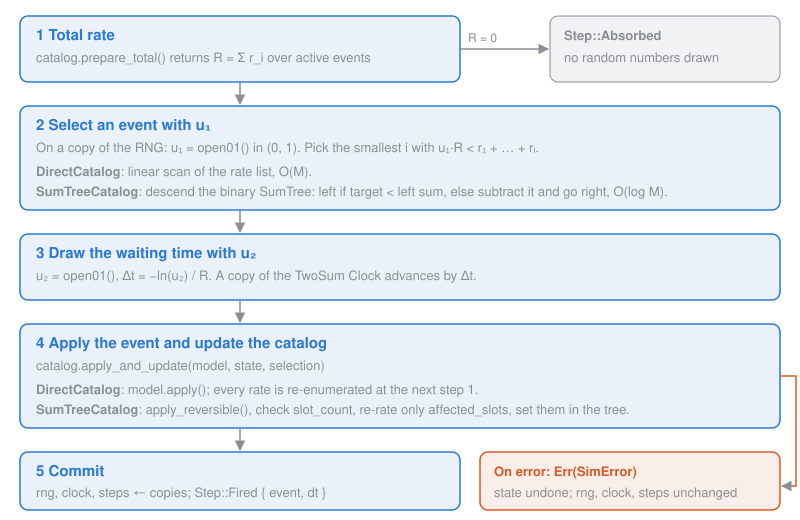
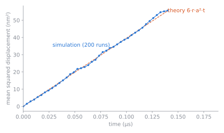
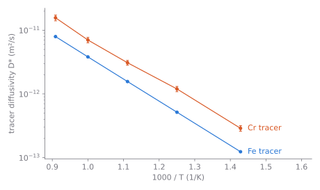

# okrates — Kinetic Monte Carlo Simulation in Rust and Python

[](https://github.com/vzordillo/okrates)
[](https://github.com/vzordillo/okrates/actions/workflows/rust.yml)
[](https://github.com/vzordillo/okrates/actions/workflows/python.yml)
[](LICENSE)

## About this repository

`okrates` is a residence-time (rejection-free) kinetic Monte Carlo (kMC) framework written in Rust, with typed Python bindings.

`okrates` is an experiment in fully agentic scientific software development. The code, tests and reviews are produced by AI coding agents working under the maintainer's direction:
- [Google Antigravity](https://antigravity.google/use-cases/science/) with Google's frontier Gemini models, through Google's free access offer for scientists;
- Anthropic Claude models through [Claude Code](https://claude.com/claude-code).

<p align="center"></p>

## What it does

- **Engine.** A model supplies its states, transitions and rates; the engine selects events, advances time and keeps the event catalog consistent. Two catalog backends give the same physics at different cost: a direct catalog (O(M) per step) and an incremental sum tree (O(k log M) per step, for k rates changed by an event). On a Linux x86_64 workstation the sum tree is about 620× faster at 32,768 events (see [Scaling](#3-scaling-why-the-sum-tree-catalog-matters)).
- **Reproducibility.** Seeded ChaCha12 random streams, separated by replica and purpose, and a compensated (TwoSum) clock. Checkpoints restore a run bit for bit on the same platform.
- **Models.** BCC vacancy diffusion, Fe–Cr transport with the Martínez et al. (2012) energetics or tabulated DFT barriers, and an Fe–Cr RIS model with ⟨110⟩ self-interstitial dumbbells, Frenkel-pair creation, recombination and a planar sink.
- **Analysis.** Mean-squared-displacement transport estimators, tracer and correlation factors with jackknife errors, Kawasaki annealing with Warren–Cowley short-range order, and extended-XYZ snapshots for visualisation (e.g. OVITO).
- **Provenance.** Run manifests with SHA-256 hashes of parameters, barrier tables and checkpoints, and validation of DFT barrier sets (detailed balance, temperature ranges).
- **Python.** Frozen configuration and result classes, numpy arrays out, and Python exceptions instead of crashes.

## Design

A kMC simulation has two parts that change for different reasons. The physics (which states exist, which transitions leave a state, and at what rate) changes with every material and mechanism. The algorithm (pick an event in proportion to its rate, advance time, keep the event list current, and do it reproducibly) is the same for every model. `okrates` keeps the two apart:

- **The model** describes physics only. It implements the `Model` trait in `crates/okrates-core/src/model.rs`: `enumerate_events` emits `(event, rate)` pairs for a state, and `apply` performs one event. `ReversibleModel` adds `apply_reversible` and `undo`, so a failed step can restore the state. `IncrementalModel` (`crates/okrates-core/src/incremental.rs`) gives every possible event a fixed integer slot and reports, through `affected_slots`, which slots an event changes. A model can also be written as two pieces, a `TransitionTopology` (what can happen) and a `RateModel` (how fast), joined by `CoupledModel` (`topology.rs`); the `catalog_scaling` example is built this way.
- **The engine** owns everything else. `Engine<M, C>` in `crates/okrates-core/src/catalog.rs` holds the model, the state, a `Clock`, a `KmcRng` and a step counter, and is generic over a `CatalogBackend` `C`. Two backends exist: `DirectCatalog` re-enumerates all events every step, and `SumTreeCatalog` keeps rates in a binary `SumTree` and updates only the affected slots. `Simulation` is `Engine<M, DirectCatalog>`; `IncrementalSimulation` is `Engine<M, SumTreeCatalog>`.
- **Reproducibility lives in the engine.** `KmcRng` (`rng.rs`) wraps ChaCha12; `KmcRng::for_replica` and `run_ensemble` (`ensemble.rs`) derive separate streams per replica and per purpose (`StreamRole::Dynamics`, `InitialState`, `Equilibration`), so parallel ensembles give the same numbers on any thread count. `Clock` (`clock.rs`) accumulates time with TwoSum compensation. `Checkpointable` (`checkpoint.rs`) serialises steps, clock, RNG and state; `Engine::resume` rebuilds the catalog from them. `sample_trajectory` (`sampler.rs`) records observables on a fixed time grid (`SampleGrid`).
- **Estimators and provenance sit on top.** `okrates-models` turns trajectories into diffusivities and correlation factors with jackknife errors; `okrates-schema` writes `RunManifest` records and validates `BarrierSet` data. The Python package wraps all of it.

Why the split pays off:
- **Swap the physics without touching the engine.** The single-vacancy, multi-vacancy, Fe–Cr and Fe–Cr RIS models all run on the same `Engine`. Within Fe–Cr, the energy model is a further seam: `FeCrModel<E: Energetics>` accepts `PairEnergetics`, `Martinez2012` or `TabulatedEnergetics`.
- **Swap the catalog without touching the physics.** Any `IncrementalModel` runs on both `Simulation` and `IncrementalSimulation`. Tests compare the two backends on the same model.
- **The guarantees are in one place.** Seeding, time accumulation, atomic steps and checkpoints are written once in `okrates-core`, so every model inherits them.

<p align="center"></p>

`okrates-schema` does not depend on `okrates-core`; `okrates-models` uses both, and `okrates-python` uses all three.

## How a step works

Every step is `Engine::step_observing` in `crates/okrates-core/src/catalog.rs`. With event rates r₁ … r_M:

1. The catalog returns the total rate R = Σ rᵢ. If R = 0 the state is absorbing and the step returns `Step::Absorbed` without drawing random numbers.
2. On a copy of the RNG, the engine draws u₁ in (0, 1) and selects the smallest i with u₁·R < r₁ + … + rᵢ. `DirectCatalog` scans the rate list; `SumTreeCatalog` descends its tree from the root.
3. It draws u₂ in (0, 1) and sets the waiting time Δt = −ln(u₂)/R. Because `KmcRng::open01` never returns 0 or 1, Δt is finite and positive.
4. The catalog applies the event and updates itself. `SumTreeCatalog` recomputes only the slots in `affected_slots` and checks that the slot count is unchanged.
5. Only if all of this succeeds are the RNG, clock and step counter replaced by their advanced copies. On any error the state is undone and the engine is exactly as before the call.

<p align="center"></p>

## Getting started

Rust 1.100.0 is pinned in `rust-toolchain.toml` (minimum supported 1.88).

```console
cargo test
cargo run --example random_walk -- 42 5
```

Python ≥ 3.10, in any virtualenv or conda environment (`numpy>=2.2` is installed as a dependency):

```console
pip install maturin==1.16.0
maturin develop
python examples/python/vacancy_diffusivity.py
```

The walkthrough below uses release builds (`cargo run --release`, `maturin develop --release`) because the runs are longer. Outputs were produced on a Linux x86_64 workstation; random numbers are reproducible, but timings and the last digits of some floating-point results can differ on other platforms.

## Walkthrough

### 1. One vacancy in BCC

**What you will learn:** how a model is written, how to run it, and how to check it against an exact result.

**Code to read:** `crates/okrates-models/src/vacancy.rs`. `VacancyDiffusion` holds a `BccLattice` and one jump rate r. Its `enumerate_events` emits the eight nearest-neighbour jumps, each with rate r; `apply` swaps the vacancy with the neighbour and adds the jump vector to the vacancy's unwrapped displacement. The rate comes from `jump_rate(ν, E_m, T) = ν exp(−E_m / k_B T)`.

For this random walk the diffusivity is known exactly. Each jump has length √3·a/2, so ⟨R²⟩ grows by 8r · 3a²/4 per unit time, and D = ⟨R²⟩/(6t) = r·a².

**Run it** (Rust; 2,000 independent runs in parallel through `run_replicas`):

```text
cargo run --release -p okrates-models --example vacancy_msd
```

```text
parameterization = illustrative parameters, not a validated Fe parameterization
cells = [4, 4, 4]
nu = 1e13 s^-1
Em = 0.65 eV
T = 800 K
a = 2.8665e-10 m
r = 8.038596403012e8 s^-1
T_end = 1.554997834612e-7 s
D_theory = 6.605171778304e-11 m^2/s
d_hat = 6.683048898106e-11 m^2/s
se = 1.067433630227e-12 m^2/s
CI_95 = [6.473835750993e-11, 6.892262045220e-11] m^2/s
z_score_vs_theory = 0.729573414189
relative_error = 1.179032467533e-2
runs = 2000
seed_base = 20261117
total_fired_steps = 2002643
```

The same check from Python, using `okrates.vacancy_trajectory`, which returns the jump times and squared displacements of one run:

```text
python examples/python/vacancy_diffusivity.py
```

```text
jump rate r = 8.038596e+08 s^-1
D_hat    = 6.559499e-11 m^2/s (200 runs x 1000 jumps)
D_theory = 6.605172e-11 m^2/s
D_hat / D_theory = 0.9931
```

**What it shows:** the estimate agrees with r·a² within statistical error (z = 0.73 in the Rust run). The figure averages the squared displacement of 200 Python runs (seeds 0–199, 1,000 jumps each) on a common time grid; the dashed line is the exact 6·r·a²·t.

<p align="center"></p>

### 2. Making it an alloy: Fe–Cr

**What you will learn:** how the same engine runs a model whose rates depend on the local chemistry, and how to compute tracer diffusivities from Python.

**Code to read:** `crates/okrates-models/src/fecr.rs` defines `FeCrModel<E: Energetics>`: one vacancy in a BCC lattice of Fe and Cr atoms. The rate of a vacancy–atom exchange depends on the energy change, which the `Energetics` implementation supplies. `crates/okrates-models/src/fecr_martinez.rs` implements `Martinez2012`, the pair and saddle-point energetics of E. Martínez, O. Senninger, C.-C. Fu, F. Soisson, Phys. Rev. B 86, 224109 (2012), [doi:10.1103/PhysRevB.86.224109](https://doi.org/10.1103/PhysRevB.86.224109). Before the dynamics, `crates/okrates-models/src/fecr_anneal.rs` can equilibrate the Fe/Cr arrangement with Kawasaki (Fe↔Cr swap) Metropolis sweeps; the GIF above shows Cr clustering during such an anneal, then a vacancy moving through the alloy. `crates/okrates-models/src/fecr_diffusion.rs` turns trajectories into tracer diffusivities D*ᵢ = slope(Σ|Δr|²/Nᵢ)/6 with jackknife standard errors over runs.

**Run it** (Python, after `maturin develop --release`):

```python
import okrates

result = okrates.run_fecr_diffusion(
    lattice=okrates.LatticeConfig(cells=(4, 4, 4), lattice_parameter_m=2.8665e-10),
    energetics=okrates.Martinez2012Config(barrier_policy="symmetric_floor"),
    cr_count=25,
    temperature_k=800.0,
    sampling=okrates.SamplingConfig(t_end=5e-8, sample_count=20, fit_method="windowed_ols"),
    anneal=okrates.AnnealConfig(sweeps=50),
    runs=16,
    seed=2026,
)
print(f"D*_Cr = {result.D_Cr:.3e} +/- {result.D_Cr_se:.1e} m^2/s")
print(f"D*_Fe = {result.D_Fe:.3e} +/- {result.D_Fe_se:.1e} m^2/s")
print(f"mean jumps per run = {result.mean_jumps:.0f}")
print(f"params_sha256 = {result.manifest.params_sha256}")
```

```text
D*_Cr = 1.118e-11 +/- 6.0e-13 m^2/s
D*_Fe = 2.364e-12 +/- 7.6e-14 m^2/s
mean jumps per run = 13673
params_sha256 = c3210d970d59ac86b574d3eb4d83dde9021ab55d1b9c0b401f815a9c9d7c9264
```

This is a 128-site box with 25 Cr atoms (about 20 % Cr) and one vacancy, annealed for 50 sweeps and then followed for 5×10⁻⁸ s in 16 runs. The result also carries the vacancy diffusivity, the correlation factor `f` and a `RunManifest` whose SHA-256 hash identifies the parameters.

**What it shows:** Cr diffuses faster than Fe in this model. The figure repeats the calculation in a dilute alloy (6×6×6 cells, 432 sites, 4 Cr atoms, one vacancy, no anneal, 128 runs, seed 2026) at 700–1100 K, with `t_end` scaled with temperature so that each run makes about 14,000–18,000 jumps. Error bars are ±2 standard errors. D*_Cr / D*_Fe falls from 2.33 at 700 K to 1.97 at 1100 K. Both diffusivities are for one vacancy in 432 sites, so their absolute values scale with that vacancy concentration.

<p align="center"></p>

### 3. Scaling: why the sum-tree catalog matters

**What you will learn:** what each catalog backend costs per step, and when to choose which.

**Code to read:** `DirectCatalog` and `SumTreeCatalog` in `crates/okrates-core/src/catalog.rs`, and `SumTree` in `crates/okrates-core/src/incremental.rs`. The direct catalog re-enumerates all M events and scans them every step. The sum tree stores partial rate sums in a complete binary tree; selection is one root-to-leaf descent, and an event that changes k rates costs k leaf-to-root updates.

**Run it:**

```text
cargo run --release -p okrates-core --example catalog_scaling
```

The example builds a synthetic `CoupledModel` (a ring of sites with four channels each, where every event changes k = 8 rates), runs it on `Simulation` and on `IncrementalSimulation` with M from 8 to 131,072, and prints CSV with the median of 5 repetitions:

```text
backend,M,rho_update,rate_skew,bytes_per_slot,steps,reps,median_ns_per_step,min_ns_per_step,max_ns_per_step
direct,8,1.000000,7.0,24.00,250000,5,132.70,132.57,329.03
sum_tree,8,1.000000,7.0,16.00,250000,5,201.98,201.77,207.03
...
direct,32768,0.000244,7.0,24.00,1000,5,275299.91,275006.83,275891.16
sum_tree,32768,0.000244,7.0,16.00,1000,5,442.81,439.91,450.55
direct,131072,0.000061,7.0,24.00,1000,5,947177.82,932889.48,1109127.43
sum_tree,131072,0.000061,7.0,16.00,1000,5,416.71,413.80,434.31
```

**What it shows:** the direct cost grows in proportion to M; the sum-tree cost stays between about 200 and 450 ns. The direct catalog is faster only for the smallest catalog (M = 8); from M = 32 on the sum tree wins, by 620× at M = 32,768. Single-threaded run on a Linux x86_64 workstation.

<p align="center"></p>

### 4. Where the RIS model fits

**What you will learn:** how a model with defect creation and annihilation uses the same engine.

**Code to read:** `crates/okrates-models/src/fecr_ris.rs` defines `FeCrRis`, the Fe–Cr radiation-induced segregation model. Its state holds lattice atoms, vacancies and ⟨110⟩ self-interstitial dumbbells (Fe–Fe, Fe–Cr or Cr–Cr). Events (`FeCrRisEvent`) are vacancy jumps, dumbbell jumps and Frenkel-pair creation at a rate set by the damage rate in dpa/s. A vacancy and an interstitial within the fourth neighbour shell recombine, and defects that reach a sink plane are absorbed. Lattice and vacancy energetics come from `Martinez2012`; the dumbbell parameters (`DumbbellParams::senninger2016_r1`) are refitted to the binding energies and barriers of O. Senninger et al., Acta Mater. 103, 1–11 (2016), [doi:10.1016/j.actamat.2015.09.058](https://doi.org/10.1016/j.actamat.2015.09.058), because the fitted values are not published. `FeCrRis` is an `IncrementalModel` with a fixed defect record capacity `P`, so it runs on `IncrementalSimulation`.

**Run it** (a 32×8×8-cell box with 10 % Cr and a sink plane at x = 0, at 600 K and 10⁻³ dpa/s, to 0.01 dpa; about 8 s):

```text
cargo run --release -p okrates-models --example fecr_ris_pilot -- --temperature 600 --k0 1e-3 --dpa-end 1e-2 --capacity 4096 --seed 1 --cells 32 8 8
```

```text
box=[32, 8, 8] sites=4096 cr=410 T=600 K0=1e-3 dpa_end=1e-2 P=4096 seed=1
progress steps=100000 t=7.042351e0 dose=7.042351e-3 V=1 I=0 V_peak=1 I_peak=1 V_mean=0.0000 I_mean=0.0000 created=27 recombined=15 absorbed_V=11 absorbed_I=12 borrowed_fe=0 creation_attempts=32 floored_dumbbell=5581 floored_vacancy=0 us_per_step=68.03
final steps=122893 t=1.020147e1 dose=1.020147e-2 V=1 I=1 V_peak=1 I_peak=1 V_mean=0.0000 I_mean=0.0000 created=38 recombined=21 absorbed_V=16 absorbed_I=16 borrowed_fe=0 creation_attempts=43 floored_dumbbell=6631 floored_vacancy=0 us_per_step=66.51
```

**What it shows:** the defect bookkeeping balances. Of 38 Frenkel pairs created, 21 recombined and 16 vacancies and 16 interstitials were absorbed at the sink, leaving 38 − 21 − 16 = 1 vacancy and 1 interstitial (`V=1 I=1`). In a box this small at this damage rate, defects are absorbed or recombine long before the next pair is created, so at most one of each exists at a time. Measuring Cr enrichment or depletion at the sink needs larger boxes and doses; this run checks only that the model and its event accounting work.

## Testing

Tests are split into tiers. The fast tier runs in a few seconds; the full tier adds statistical, equivalence and end-to-end tests:

```text
cargo test --locked                          # fast tier
cargo test --locked -- --include-ignored     # full tier
pytest -q python/tests                       # Python, after maturin develop
```

Regression tests pin results bit for bit. Where platform maths libraries differ in the last bit, values are pinned per target (architecture and operating system).

## License

[MIT](LICENSE)
