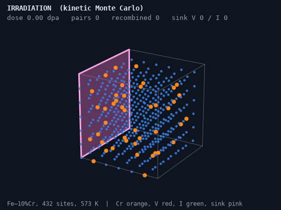
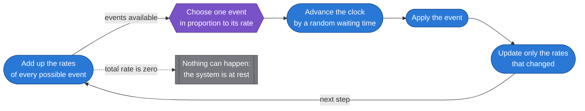

# okrates — Kinetic Monte Carlo Simulation in Rust and Python

[](https://github.com/vzordillo/okrates)
[](https://github.com/vzordillo/okrates/actions/workflows/rust.yml)
[](https://github.com/vzordillo/okrates/actions/workflows/python.yml)
[](LICENSE)

## About this repository

`okrates` is a residence-time (rejection-free) kinetic Monte Carlo (kMC) framework written in Rust, with typed Python bindings.

`okrates` is an experiment in fully agentic scientific software development. The code, tests and reviews are produced by AI coding agents working under the maintainer's direction:
- [Google Antigravity](https://antigravity.google/use-cases/science/) with Google's frontier Gemini models, through Google's free access offer for scientists;
- Anthropic Claude models through [Claude Code](https://claude.com/claude-code).

<table>
  <tr>
    <td width="50%"></td>
    <td width="50%"></td>
  </tr>
  <tr>
    <td>Thermal ageing of Fe–20 % Cr (Martínez 2012 energetics, 432 BCC sites, 769 K): Cr atoms cluster during 400 Kawasaki Monte Carlo sweeps, then a single vacancy makes 4,000 kinetic Monte Carlo jumps through the alloy.</td>
    <td>Irradiation of Fe–10 % Cr (432 BCC sites, 573 K, accelerated damage rate of 3×10⁴ dpa/s): Frenkel pairs of vacancies and self-interstitial dumbbells are created, the dumbbells migrate quickly, and the defects recombine or are absorbed at the sink plane (pink). Over 6,000 events (1.5 dpa), 560 of 588 pairs recombine and the rest reach the sink.</td>
  </tr>
</table>

## What it does

okrates runs continuous-time Markov chains in the residence-time (BKL) form. A model says which events can happen from a state and how fast; the engine picks one in proportion to its rate, advances the clock and applies it. Two event catalogs give identical physics at different cost. The direct catalog re-enumerates all M events every step, and the sum-tree catalog updates only the k rates an event changes, at O(k log M) per step. At 32,768 events the sum tree is about 620 times faster on our Linux x86_64 workstation.

Random numbers come from seeded ChaCha12 streams, one per replica and purpose, and time is accumulated with a compensated (TwoSum) sum. A checkpoint stores the full generator and clock state, so a resumed run continues bit for bit on the same platform.

The models so far are vacancy diffusion in BCC lattices, Fe–Cr transport with the Martínez et al. (2012) energetics or with tabulated DFT barriers, and an Fe–Cr radiation-induced segregation (RIS) model with ⟨110⟩ self-interstitial dumbbells, Frenkel-pair creation, recombination and a planar sink. On top of these we compute tracer diffusivities and correlation factors with jackknife errors, anneal alloys with Kawasaki swaps, measure Warren–Cowley short-range order, and write extended-XYZ frames that OVITO can read. Run manifests record SHA-256 hashes of parameters, barrier tables and checkpoints, and DFT barrier sets are checked for detailed balance before use. The Python package returns numpy arrays and raises Python exceptions instead of crashing.

## Design

A kMC code has two parts that change for different reasons. The physics (which states exist, which transitions leave a state, and at what rate) changes with every material and mechanism. The algorithm (pick an event in proportion to its rate, advance time, keep the event list current, and do it reproducibly) is the same for all of them. okrates keeps the two apart.

A model describes physics only. It implements the `Model` trait in `crates/okrates-core/src/model.rs`: `enumerate_events` emits `(event, rate)` pairs for a state, and `apply` performs one event. `ReversibleModel` adds `apply_reversible` and `undo`, so a failed step can restore the state. `IncrementalModel` (`crates/okrates-core/src/incremental.rs`) gives every possible event a fixed integer slot and reports, through `affected_slots`, which slots an event changes. A model can also be split into a `TransitionTopology` (what can happen) and a `RateModel` (how fast), joined by `CoupledModel` in `topology.rs`; the `catalog_scaling` example is built that way.

The engine owns everything else. `Engine<M, C>` in `crates/okrates-core/src/catalog.rs` holds the model, the state, a `Clock`, a `KmcRng` and a step counter, and is generic over a `CatalogBackend` `C`. `DirectCatalog` re-enumerates all events every step; `SumTreeCatalog` keeps rates in a binary `SumTree` and updates only the affected slots. `Simulation` is `Engine<M, DirectCatalog>` and `IncrementalSimulation` is `Engine<M, SumTreeCatalog>`.

Reproducibility is handled in the engine as well. `KmcRng` (`rng.rs`) wraps ChaCha12, and `KmcRng::for_replica` and `run_ensemble` (`ensemble.rs`) derive separate streams per replica and per purpose (`StreamRole::Dynamics`, `InitialState`, `Equilibration`), so a parallel ensemble gives the same numbers on any thread count. `Clock` (`clock.rs`) accumulates time with TwoSum compensation. `Checkpointable` (`checkpoint.rs`) serialises steps, clock, RNG and state, and `Engine::resume` rebuilds the catalog from them. `sample_trajectory` (`sampler.rs`) records observables on a fixed time grid (`SampleGrid`).

`okrates-models` turns trajectories into diffusivities and correlation factors, `okrates-schema` writes `RunManifest` records and validates `BarrierSet` data, and the Python package wraps both. `okrates-schema` does not depend on `okrates-core`; `okrates-models` uses both, and `okrates-python` uses all three.

```mermaid
flowchart LR
    subgraph you["🧪 Your model"]
        direction TB
        states(["States<br>atoms, defects, species"])
        moves(["Transitions<br>what can happen next"])
        rates(["Rates<br>how fast it happens"])
    end
    subgraph core["⚙️ okrates engine"]
        direction TB
        pick{{"Event selection"}}
        clock{{"Continuous-time clock"}}
        rng{{"Independent random streams"}}
        ckpt{{"Exact checkpoints"}}
    end
    subgraph out["📈 Results"]
        direction TB
        traj[/"Trajectories"/]
        transport[/"Diffusivities and<br>correlation factors"/]
        prov[/"Provenance records"/]
    end
    you ==> core ==> out
    py["🐍 Python"] -.-> you
    rs["🦀 Rust"] -.-> you
    classDef model fill:#2a78d6,stroke:#1b4f8f,color:#ffffff
    classDef engine fill:#7a52c7,stroke:#4d3285,color:#ffffff
    classDef result fill:#1f9e78,stroke:#13664d,color:#ffffff
    classDef lang fill:#d95926,stroke:#8f3a18,color:#ffffff
    class states,moves,rates model
    class pick,clock,rng,ckpt engine
    class traj,transport,prov result
    class py,rs lang
```



Because of this split, the single-vacancy, multi-vacancy, Fe–Cr and RIS models all run on the same `Engine`. Within Fe–Cr the energy model is a further seam: `FeCrModel<E: Energetics>` accepts `PairEnergetics`, `Martinez2012` or `TabulatedEnergetics`. Any `IncrementalModel` runs on both `Simulation` and `IncrementalSimulation`, and the tests compare the two backends on the same model. Seeding, time accumulation, atomic steps and checkpoints are written once in `okrates-core`, and every model inherits them.

## How a step works

Every step is `Engine::step_observing` in `crates/okrates-core/src/catalog.rs`. With event rates r₁ … r_M, the catalog first returns the total rate R = Σ rᵢ. If R = 0 the state is absorbing, and the step returns `Step::Absorbed` without drawing random numbers. Otherwise the engine draws u₁ in (0, 1) on a copy of the generator and selects the smallest i with u₁·R < r₁ + … + rᵢ; `DirectCatalog` scans the rate list and `SumTreeCatalog` descends its tree from the root. It then draws u₂ and sets the waiting time Δt = −ln(u₂)/R. `KmcRng::open01` never returns 0 or 1, so Δt is finite and positive.

The catalog then applies the event and updates itself; `SumTreeCatalog` recomputes only the slots in `affected_slots` and checks that the slot count has not changed. The generator, clock and step counter are replaced by their advanced copies only if all of this succeeds. On any error the state is undone and the engine is exactly as it was before the call.



## Getting started

Rust 1.100.0 is pinned in `rust-toolchain.toml` (minimum supported 1.88).

```console
cargo test
cargo run --example random_walk -- 42 5
```

Python ≥ 3.10, in any virtualenv or conda environment (`numpy>=2.2` is installed as a dependency):

```console
pip install maturin==1.16.0
maturin develop
python examples/python/vacancy_diffusivity.py
```

The walkthrough below uses release builds (`cargo run --release`, `maturin develop --release`) because the runs are longer. The outputs shown were produced on a Linux x86_64 workstation. Random numbers are reproducible, but timings and the last digits of some floating-point results can differ on other platforms.

## Walkthrough

### 1. One vacancy in BCC

We start with the simplest model, because its answer is known exactly. `VacancyDiffusion` in `crates/okrates-models/src/vacancy.rs` holds a `BccLattice` and one jump rate r. Its `enumerate_events` emits the eight nearest-neighbour jumps, each with rate r, and `apply` swaps the vacancy with that neighbour and adds the jump vector to the vacancy's unwrapped displacement. The rate is `jump_rate(ν, E_m, T) = ν exp(−E_m / k_B T)`.

Each jump has length √3·a/2, so ⟨R²⟩ grows by 8r · 3a²/4 per unit time and D = ⟨R²⟩/(6t) = r·a². The `vacancy_msd` example estimates D from 2,000 independent runs, run in parallel through `run_replicas`:

```text
cargo run --release -p okrates-models --example vacancy_msd
```

```text
parameterization = illustrative parameters, not a validated Fe parameterization
cells = [4, 4, 4]
nu = 1e13 s^-1
Em = 0.65 eV
T = 800 K
a = 2.8665e-10 m
r = 8.038596403012e8 s^-1
T_end = 1.554997834612e-7 s
D_theory = 6.605171778304e-11 m^2/s
d_hat = 6.683048898106e-11 m^2/s
se = 1.067433630227e-12 m^2/s
CI_95 = [6.473835750993e-11, 6.892262045220e-11] m^2/s
z_score_vs_theory = 0.729573414189
relative_error = 1.179032467533e-2
runs = 2000
seed_base = 20261117
total_fired_steps = 2002643
```

The estimate is 0.73 standard errors from r·a². The same check runs from Python, where `okrates.vacancy_trajectory` returns the jump times and squared displacements of one run:

```text
python examples/python/vacancy_diffusivity.py
```

```text
jump rate r = 8.038596e+08 s^-1
D_hat    = 6.559499e-11 m^2/s (200 runs x 1000 jumps)
D_theory = 6.605172e-11 m^2/s
D_hat / D_theory = 0.9931
```

The figure averages the squared displacement of 200 Python runs (seeds 0–199, 1,000 jumps each) on a common time grid. The dashed line is the exact 6·r·a²·t.

<p align="center"></p>

### 2. Making it an alloy: Fe–Cr

Next we put the vacancy in an alloy, where the jump rate depends on the local chemistry. `FeCrModel<E: Energetics>` in `crates/okrates-models/src/fecr.rs` holds one vacancy in a BCC lattice of Fe and Cr atoms, and the `Energetics` implementation supplies the energy change of each vacancy–atom exchange. `Martinez2012` in `crates/okrates-models/src/fecr_martinez.rs` implements the pair and saddle-point energetics of E. Martínez, O. Senninger, C.-C. Fu and F. Soisson, Phys. Rev. B 86, 224109 (2012), [doi:10.1103/PhysRevB.86.224109](https://doi.org/10.1103/PhysRevB.86.224109).

Before the dynamics, `crates/okrates-models/src/fecr_anneal.rs` can equilibrate the Fe/Cr arrangement with Kawasaki (Fe↔Cr swap) Metropolis sweeps. The left animation at the top shows Cr clustering during such an anneal, followed by a vacancy moving through the alloy. `crates/okrates-models/src/fecr_diffusion.rs` turns the trajectories into tracer diffusivities D*ᵢ = slope(Σ|Δr|²/Nᵢ)/6, with jackknife standard errors over runs. From Python, after `maturin develop --release`:

```python
import okrates

result = okrates.run_fecr_diffusion(
    lattice=okrates.LatticeConfig(cells=(4, 4, 4), lattice_parameter_m=2.8665e-10),
    energetics=okrates.Martinez2012Config(barrier_policy="symmetric_floor"),
    cr_count=25,
    temperature_k=800.0,
    sampling=okrates.SamplingConfig(t_end=5e-8, sample_count=20, fit_method="windowed_ols"),
    anneal=okrates.AnnealConfig(sweeps=50),
    runs=16,
    seed=2026,
)
print(f"D*_Cr = {result.D_Cr:.3e} +/- {result.D_Cr_se:.1e} m^2/s")
print(f"D*_Fe = {result.D_Fe:.3e} +/- {result.D_Fe_se:.1e} m^2/s")
print(f"mean jumps per run = {result.mean_jumps:.0f}")
print(f"params_sha256 = {result.manifest.params_sha256}")
```

```text
D*_Cr = 1.118e-11 +/- 6.0e-13 m^2/s
D*_Fe = 2.364e-12 +/- 7.6e-14 m^2/s
mean jumps per run = 13673
params_sha256 = c3210d970d59ac86b574d3eb4d83dde9021ab55d1b9c0b401f815a9c9d7c9264
```

This is a 128-site box with 25 Cr atoms (about 20 % Cr) and one vacancy, annealed for 50 sweeps and then followed for 5×10⁻⁸ s in 16 runs. The result also carries the vacancy diffusivity, the correlation factor `f` and a `RunManifest` whose SHA-256 hash identifies the parameters.

Cr diffuses faster than Fe in this model. The figure repeats the calculation in a dilute alloy (6×6×6 cells, 432 sites, 4 Cr atoms, one vacancy, no anneal, 128 runs, seed 2026) between 700 and 1100 K, with `t_end` scaled so that each run makes about 14,000–18,000 jumps. Error bars are ±2 standard errors. The ratio D*_Cr / D*_Fe is 2.33, 2.32, 1.97, 1.84 and 1.97 at 700, 800, 900, 1000 and 1100 K. Both diffusivities are for one vacancy in 432 sites, so their absolute values scale with that vacancy concentration.

<p align="center"></p>

### 3. Scaling: why the sum-tree catalog matters

The two catalog backends are `DirectCatalog` and `SumTreeCatalog` in `crates/okrates-core/src/catalog.rs`, with `SumTree` in `crates/okrates-core/src/incremental.rs`. The direct catalog re-enumerates all M events and scans them every step. The sum tree stores partial rate sums in a complete binary tree, so selection is one root-to-leaf descent and an event that changes k rates costs k leaf-to-root updates. The `catalog_scaling` example measures both:

```text
cargo run --release -p okrates-core --example catalog_scaling
```

It builds a synthetic `CoupledModel`, a ring of sites with four channels each in which every event changes k = 8 rates, runs it on `Simulation` and on `IncrementalSimulation` with M from 8 to 131,072, and prints CSV with the median of 5 repetitions:

```text
backend,M,rho_update,rate_skew,bytes_per_slot,steps,reps,median_ns_per_step,min_ns_per_step,max_ns_per_step
direct,8,1.000000,7.0,24.00,250000,5,132.70,132.57,329.03
sum_tree,8,1.000000,7.0,16.00,250000,5,201.98,201.77,207.03
...
direct,32768,0.000244,7.0,24.00,1000,5,275299.91,275006.83,275891.16
sum_tree,32768,0.000244,7.0,16.00,1000,5,442.81,439.91,450.55
direct,131072,0.000061,7.0,24.00,1000,5,947177.82,932889.48,1109127.43
sum_tree,131072,0.000061,7.0,16.00,1000,5,416.71,413.80,434.31
```

The direct cost grows in proportion to M, while the sum-tree cost stays between about 200 and 450 ns per step. The direct catalog is faster only at M = 8; from M = 32 on the sum tree wins, by a factor of 620 at M = 32,768.

<p align="center"></p>
<p align="center"><em>Median time per step of the catalog_scaling example, single-threaded, Linux x86_64 workstation.</em></p>

### 4. Where the RIS model fits

The last model creates and removes defects during the run, and it uses the same engine. `FeCrRis` in `crates/okrates-models/src/fecr_ris.rs` is the Fe–Cr radiation-induced segregation model. Its state holds lattice atoms, vacancies and ⟨110⟩ self-interstitial dumbbells (Fe–Fe, Fe–Cr or Cr–Cr). The events (`FeCrRisEvent`) are vacancy jumps, dumbbell jumps and Frenkel-pair creation at a rate set by the damage rate in dpa/s. A vacancy and an interstitial within the fourth neighbour shell recombine, and defects that reach a sink plane are absorbed.

The lattice and vacancy energetics come from `Martinez2012`. The dumbbell parameters (`DumbbellParams::senninger2016_r1`) are refitted to the binding energies and barriers of O. Senninger et al., Acta Mater. 103, 1–11 (2016), [doi:10.1016/j.actamat.2015.09.058](https://doi.org/10.1016/j.actamat.2015.09.058), because the fitted values are not published. `FeCrRis` is an `IncrementalModel` with a fixed defect record capacity `P`, so it runs on `IncrementalSimulation`. A 32×8×8-cell box with 10 % Cr and a sink plane at x = 0, at 600 K and 10⁻³ dpa/s to 0.01 dpa, takes about 8 s:

```text
cargo run --release -p okrates-models --example fecr_ris_pilot -- --temperature 600 --k0 1e-3 --dpa-end 1e-2 --capacity 4096 --seed 1 --cells 32 8 8
```

```text
box=[32, 8, 8] sites=4096 cr=410 T=600 K0=1e-3 dpa_end=1e-2 P=4096 seed=1
progress steps=100000 t=7.042351e0 dose=7.042351e-3 V=1 I=0 V_peak=1 I_peak=1 V_mean=0.0000 I_mean=0.0000 created=27 recombined=15 absorbed_V=11 absorbed_I=12 borrowed_fe=0 creation_attempts=32 floored_dumbbell=5581 floored_vacancy=0 us_per_step=68.03
final steps=122893 t=1.020147e1 dose=1.020147e-2 V=1 I=1 V_peak=1 I_peak=1 V_mean=0.0000 I_mean=0.0000 created=38 recombined=21 absorbed_V=16 absorbed_I=16 borrowed_fe=0 creation_attempts=43 floored_dumbbell=6631 floored_vacancy=0 us_per_step=66.51
```

The defect bookkeeping balances. Of 38 Frenkel pairs, 21 recombined and 16 vacancies and 16 interstitials were absorbed at the sink, which leaves 38 − 21 − 16 = 1 vacancy and 1 interstitial (`V=1 I=1`). In a box this small at this damage rate, defects are absorbed or recombine before the next pair is created, so at most one of each exists at a time. Measuring Cr enrichment or depletion at the sink needs larger boxes and higher doses; this run only checks that the model and its event accounting work.

## Testing

The fast tier runs in a few seconds; the full tier adds statistical, equivalence and end-to-end tests:

```text
cargo test --locked                          # fast tier
cargo test --locked -- --include-ignored     # full tier
pytest -q python/tests                       # Python, after maturin develop
```

Regression tests pin results bit for bit. Where platform maths libraries differ in the last bit, we pin values per target (architecture and operating system).

## License

[MIT](LICENSE)
